

  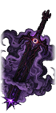
  &nbsp;&nbsp;
  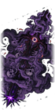

<h1 align="center">Chaos Weapon Mod</h1>

  A <b>Battle Brothers</b> mod (game version 1.5.0.14) built around <b>Chaos Mind</b>, a legendary two-handed sword 
  that grows stronger with every life it takes, friend or foe.

  <a href="../../releases/latest"><b>Download the latest release</b></a> ·
  In game the mod registers as <b>Chaos Mind</b> (<code>mod_chaos_mind</code>)

---

## Contents

- [Installing](#installing)
- [Abilities at a glance](#abilities-at-a-glance)
- [The Frozen Eye](#the-frozen-eye)
- [Chaos Mind](#chaos-mind)
- [Carnal Storage](#carnal-storage)
- [Brother and Mass Sacrifice](#brother-and-mass-sacrifice)
- [Soul Arrow](#soul-arrow)
- [Armor Fixer](#armor-fixer)
- [Perks](#perks)
- [The Black Skull](#the-black-skull)
- [Leader duels](#leader-duels)
- [Chaos Guide](#chaos-guide)
- [Hotkeys](#hotkeys)
- [Status](#status)

## Installing

**Requires:**
- [Modding Standards & Utilities (MSU)](https://www.nexusmods.com/battlebrothers/mods/479) 1.2.0 or later
- [Modern Hooks](https://www.nexusmods.com/battlebrothers/mods/685)

**Steps:**
1. Download `mod_chaos_mind.zip` from the [latest release](../../releases/latest).
2. Put it in the game's `data` folder, next to MSU and Modern Hooks.

To build the zip yourself, zip the folders `brushes`, `chaos_mind`, `gfx`, `scripts` and `ui` so that they sit at the top level of the zip.

> [!WARNING]
> Removing the mod breaks any save that contains the sword, The Frozen Eye, the Soul Arrow, an Armor Fixer or the Chaos Guide.

## Abilities at a glance

| | Name | What it is | Cost |
|:-:|---|---|---|
| 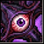 | **Carnal Storage** | Trade fatigue, blood or flesh for energy; spend energy on damage | 0 AP |
| 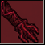 | **Brother Sacrifice** | Kill one adjacent brother for energy and a blade kill | 4 AP, 10 fatigue |
| 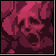 | **Mass Sacrifice** | Kill every adjacent brother | 6 AP, 25 fatigue |
| 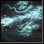 | **Soul Arrow** | +3 AP this turn, once per battle | 0 AP, 20 fatigue |
| 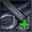 | **Use Armor Fixer** | Repairs up to 50 armor, single use | 3 AP |
| 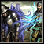 | **Fatigue Transfer** | Push all your fatigue onto an adjacent enemy | 1 AP, every 3 turns |
| 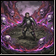 | **Chaos Circle** | A Geist's scream on 7 tiles, sharpened by your Resolve | 6 AP, 30 fatigue, every 3 turns |

| | Perk | Tier |
|:-:|---|:-:|
| 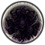 | **Chaos Protection** | 1 |
| 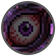 | **Only Chaos Matters** | 3 |
| 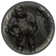 | **Used to It** | 4 |
| 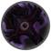 | **Chaos Armor** | 5 |
| 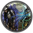 | **Fatigue Transfer** | 6 |
| 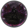 | **Chaos Circle** | 7 |

| | Item | Slot |
|:-:|---|---|
| 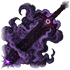 | **Chaos Mind** | Two-handed weapon |
| 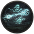 | **Soul Arrow** | Quiver |
| 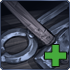 | **Armor Fixer** | Bag |
| 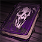 | **Chaos Guide** | Stash only |

## The Frozen Eye

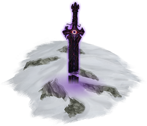

Chaos Mind is buried point-first in a mound of snow far in the frozen north. There is one per campaign, on snow or snowy forest, at least 6 tiles from any settlement.

**Ctrl+F** on the world map shows which way it lies and how far away it is.

The eye demands **eight lives**:
- You choose the eight brothers yourself, in a window that unlocks **Offer them** at exactly eight.
- You need at least eight eligible brothers, plus one who stays. Your player character can never be offered.
- If the stash is full, nothing happens and nobody dies.
- The sword starts with **8 kills**, one for each life. The Chaos Guide comes with it.

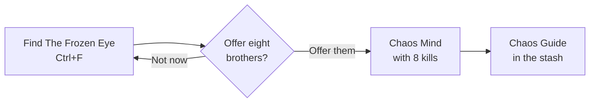

 

## Chaos Mind

  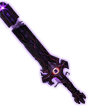
  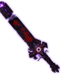
  &nbsp;&nbsp;→&nbsp;&nbsp;
  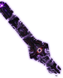
  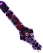

A legendary greatsword (Overhead Strike, Split, Swing) with **100–120** base damage.

**Damage:**
- **+0.5% per point of Melee Skill**, or **+1%** with the Chaos Armor perk.
- **+1% for every 10 kills**, with no cap.

Every hit also does the following:

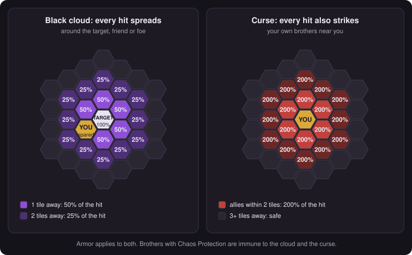

Every death the blade causes counts as a kill, brothers included. As kills pile up:

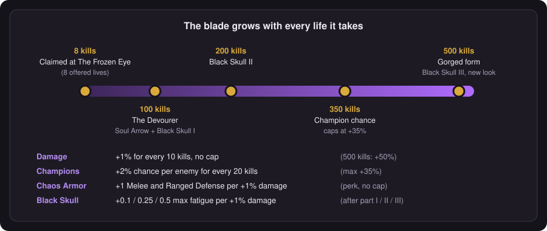

- **Draws champions:** at the start of each battle the wielder fights in, every enemy that can be a champion rolls an extra chance to become one.
- **100 kills:** the blade awakens as **Chaos Mind, the Devourer** and gives the company the Soul Arrow.
- **500 kills, the gorged form:**
  - The sword gets a new look.
  - Every kill improves the wielder's mood.
  - After a sacrifice, he turns Confident.

## Carnal Storage

The wielder feeds the eye with his own body, stores the energy, and spends it on damage until the battle ends. Energy and bonuses are lost after every battle.

 

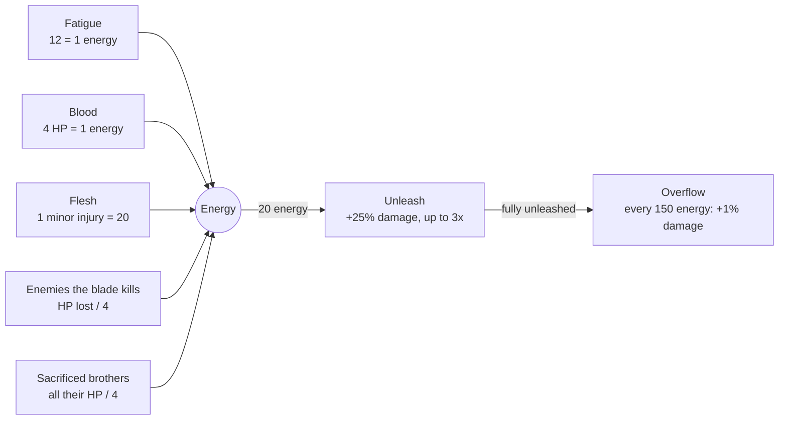

## Brother and Mass Sacrifice

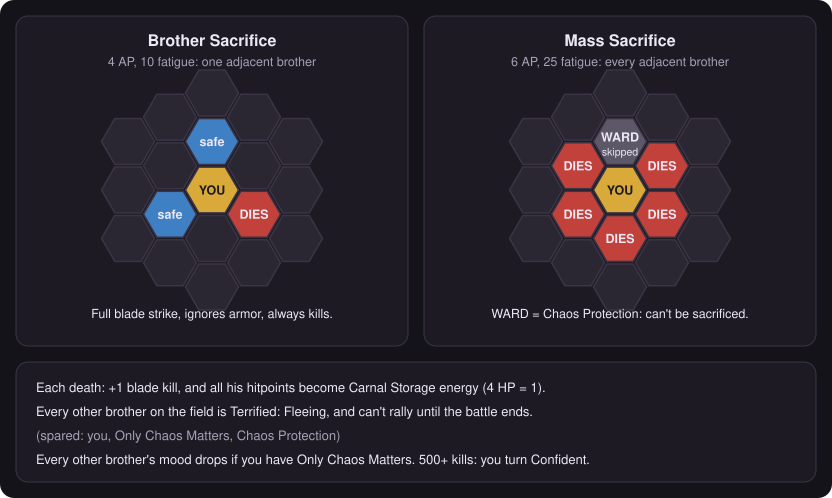

## Soul Arrow

The Devourer's gift when any of the company's Chaos Mind blades reaches **100 kills**, once per campaign.

 

- **Slot:** the quiver, but it holds no arrows, so a bow can't shoot with it.
- **Use:** once per battle, **+3 AP** this turn, even at full AP. Costs 20 fatigue.
- **Recharge:** after a battle it takes **15 ammo** from the company's supplies. With less than that, it stays empty until a later battle.

## Armor Fixer

A field repair kit; every armorer, north and south, stocks up to 3. Carry it in a bag slot. Using it costs 3 AP and repairs up to **50 armor**, body first, then the helmet. It's greyed out when there's nothing to repair.

 

## Perks

| | Perk | Effect |
|:-:|---|---|
|  | **Chaos Protection** (tier 1) | Immune to the black cloud and the curse. Can't be sacrificed. Never flees from sacrifice terror. Untouched by Chaos Circle. **−20 Resolve.** |
|  | **Only Chaos Matters** (tier 3) | Immune to Hexe charm and Geist screams. No morale loss when allies die. Never flees from sacrifice terror. Other brothers can't raise his morale, and they come to hate him: mood drops after each sacrifice, after each battle and every day. |
|  | **Used to It** (tier 4) | Every attack that misses him gives +1 Melee and Ranged Defense until the battle ends, up to +10. Dodging costs no fatigue. |
|  | **Chaos Armor** (tier 5) | While wielding Chaos Mind: +1 Melee and Ranged Defense per +1% damage from kills, no cap. Melee Skill scaling doubles to +1% per point. |
|  | **Fatigue Transfer** (tier 6) | Grants the skill: 1 AP, moves all your fatigue onto an adjacent enemy (up to his maximum). Once every 3 turns. |
|  | **Chaos Circle** (tier 7) | Grants the skill below, usable only with Chaos Mind in hand. |

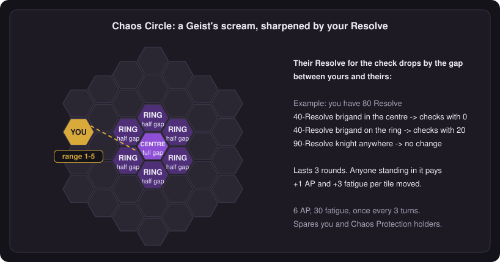

## The Black Skull

A three-part hunt that opens as the blade feeds: **100**, **200** and **500** kills, in order.

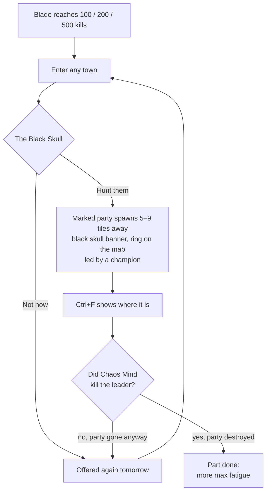

| Part | Kills | Enemy | Reward rate |
|:-:|:-:|---|:-:|
| I | 100 | Black Skull Brigands, led by a brigand champion | 0.1 |
| II | 200 | Black Skull Reavers, led by a barbarian champion | 0.25 |
| III | 500 | Black Skull Warband, led by an orc warlord champion | 0.5 |

**Reward:** while wielding Chaos Mind, the brother gets **extra max fatigue equal to the rate × the blade's damage bonus from kills**, rounded down. It keeps growing as the blade kills.

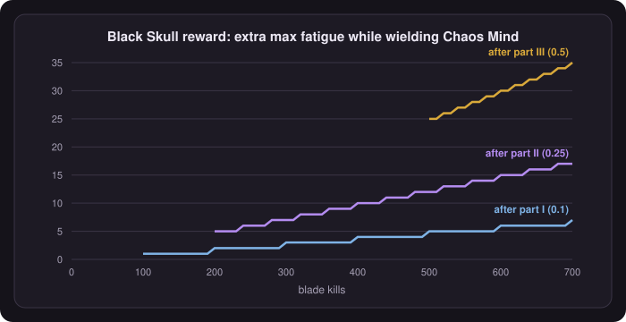

## Leader duels

Not tied to Chaos Mind. When you engage a hostile party that has a leader, he may step out and demand single combat. Each party asks at most once.

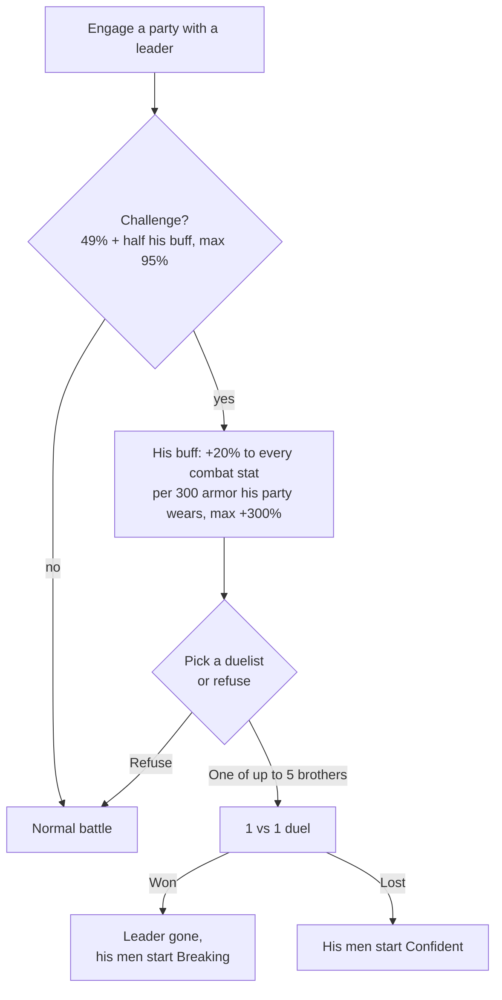

## Chaos Guide

A book with the full explanation of every item, skill and perk above, so the tooltips can stay short. It's given with the sword. If it's ever lost or sold, Chaos Mind's next kill puts it back in the stash. Open it with **Ctrl+G** on the world map or in battle, or right-click it in the stash.

 

## Hotkeys

| Key | Where | What |
|---|---|---|
| **Ctrl+F** | World map | Where The Frozen Eye is; once the sword is claimed, where the Black Skull's marked party is |
| **Ctrl+G** | World map, battle | Open or close the Chaos Guide |

All of them can be changed in Mod Settings.

## Status

Built and tested piece by piece. A few features haven't been tried in play yet: the leader duel since its last fix, Chaos Circle's resolve-gap scream, and parts 2 and 3 of the Black Skull. The game's own scripts are encrypted, so some names had to be guessed. Every guessed name is guarded: a wrong one logs a warning in `log.html` instead of crashing.

## Art

The sword, perk and skill icons and the sword's sprites were made from separate source images, which aren't included here. A few icons are recoloured vanilla Battle Brothers art: the Chaos Guide book and the Armor Fixer. The Black Skull's map banner is the game's own. The diagrams in `docs/images` are generated by `docs/make_diagrams.py`.
