

  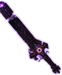
  &nbsp;&nbsp;&nbsp;&nbsp;
  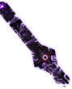

<h1 align="center">Chaos Weapon Mod</h1>

  A <b>Battle Brothers</b> mod (game version 1.5.0.14) built around <b>Chaos Mind</b>, a legendary two-handed sword 
  that grows stronger with every life it takes, friend or foe.

  <a href="../../releases/latest"><b>Download the latest release</b></a> ·
  In game the mod registers as <b>Chaos Mind</b> (<code>mod_chaos_mind</code>) ·
  <a href="#license-and-credit">CC BY 4.0</a>

  
   
  <a href="https://youtu.be/X89l6bGgo6Y"><b>Watch the demo on YouTube</b></a> (9 min)

---

## Contents

- [Installing](#installing)
- [Abilities at a glance](#abilities-at-a-glance)
- [The Frozen Eye](#the-frozen-eye)
- [Chaos Mind](#chaos-mind)
- [Carnal Storage](#carnal-storage)
- [Brother and Mass Sacrifice](#brother-and-mass-sacrifice)
- [Soul Arrow](#soul-arrow)
- [Armor Fixer](#armor-fixer)
- [Perks](#perks)
- [The Black Skull](#the-black-skull)
- [Army of the Past](#army-of-the-past)
- [Aura of 10](#aura-of-10)
- [The Red Dragon](#the-red-dragon)
- [Leader duels](#leader-duels)
- [Chaos Guide](#chaos-guide)
- [Hotkeys](#hotkeys)
- [Mod Settings](#mod-settings)
- [Status](#status)
- [License and credit](#license-and-credit)

## Installing

**Requires:**
- [Modding Standards & Utilities (MSU)](https://www.nexusmods.com/battlebrothers/mods/479) 1.2.0 or later
- [Modern Hooks](https://www.nexusmods.com/battlebrothers/mods/685)

**Steps:**
1. Download `mod_chaos_mind.zip` from the [latest release](../../releases/latest).
2. Put it in the game's `data` folder, next to MSU and Modern Hooks.

To build the zip yourself, zip the folders `brushes`, `chaos_mind`, `gfx`, `scripts` and `ui` so that they sit at the top level of the zip.

> [!NOTE]
> **Optional, off by default:** Mod Settings → Chaos Mind → Dev / Game breaking → *Saves load without the mod (experimental)*. With it on, saves keep the mod's items, perks and contracts as plain data so they still load if the mod is removed, and get them back when it's installed again. Before the sword is claimed, saves always need the mod.
>
> **Leader duels and the Red Dragon are off by default** (Mod Settings → Chaos Mind → Dev / Game breaking): both are experimental and have broken battles.

## Abilities at a glance

| | Name | What it is | Cost |
|:-:|---|---|---|
| 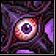 | **Carnal Storage** | Trade fatigue, blood or flesh for energy; spend energy on damage | 0 AP |
| 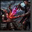 | **Brother Sacrifice** | Kill one adjacent brother for energy and a blade kill | 4 AP, 10 fatigue |
| 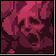 | **Mass Sacrifice** | Kill every adjacent brother | 6 AP, 25 fatigue |
| 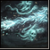 | **Soul Arrow** | +3 AP this turn, once per battle | 0 AP, 20 fatigue |
| 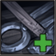 | **Use Armor Fixer** | Repairs up to 50 armor, single use | 3 AP |
| 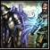 | **Fatigue Transfer** | Push all your fatigue onto an adjacent enemy | 1 AP, every 3 turns |
| 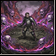 | **Chaos Circle** | A Geist's scream on 7 tiles, sharpened by your Resolve | 6 AP, 30 fatigue, every 3 turns |

| | Perk | Tier |
|:-:|---|:-:|
| 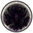 | **Chaos Protection** | 1 |
| 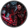 | **Vampire Allegiance** | 2 |
| 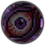 | **Only Chaos Matters** | 3 |
|  | **Troll Allegiance** | 3 |
| 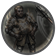 | **Used to It** | 4 |
| 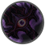 | **Chaos Armor** | 5 |
| 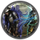 | **Fatigue Transfer** | 6 |
| 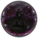 | **Chaos Circle** | 7 |

| | Item | Slot |
|:-:|---|---|
| 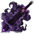 | **Chaos Mind** | Two-handed weapon |
| 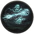 | **Soul Arrow** | Quiver |
| 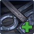 | **Armor Fixer** | Bag |
| 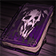 | **Chaos Guide** | Stash only |

## The Frozen Eye

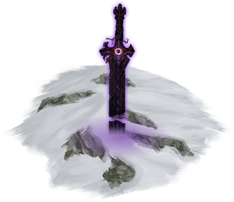

Chaos Mind is buried point-first in a mound of snow far in the frozen north. There is one per campaign, on snow or snowy forest, at least 6 tiles from any settlement.

**Ctrl+F** on the world map shows which way it lies and how far away it is.

The eye demands **eight lives**:
- You choose the eight brothers yourself, in a window that unlocks **Offer them** at exactly eight.
- You need at least eight eligible brothers, plus one who stays. Your player character can never be offered.
- If the stash is full, nothing happens and nobody dies.
- The sword starts with **8 kills**, one for each life. The Chaos Guide comes with it.

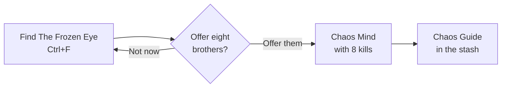

 

## Chaos Mind

  
  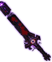
  &nbsp;&nbsp;→&nbsp;&nbsp;
  
  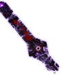

A legendary greatsword (Overhead Strike, Split, Swing) with **100–120** base damage.

**Damage:**
- **+0.5% per point of Melee Skill**, or **+1%** with the Chaos Armor perk.
- **+1% for every 10 kills**, with no cap.

Every hit also does the following:

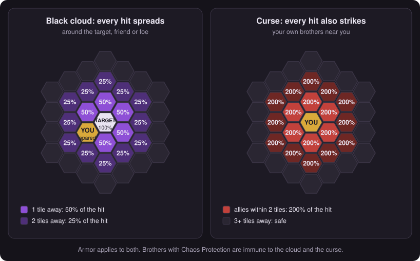

Every death the blade causes counts as a kill, brothers included. As kills pile up:

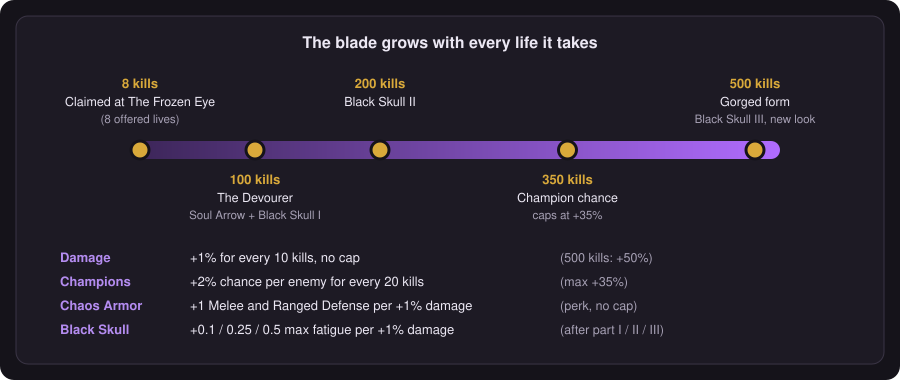

- **Draws champions:** at the start of each battle the wielder fights in, every enemy that can be a champion rolls an extra chance to become one.
- **100 kills:** the blade awakens as **Chaos Mind, the Devourer** and gives the company the Soul Arrow.
- **500 kills, the gorged form:**
  - The sword gets a new look.
  - Every kill improves the wielder's mood.
  - After a sacrifice, he turns Confident.

## Carnal Storage

The wielder feeds the eye with his own body, stores the energy, and spends it on damage until the battle ends. Energy and bonuses are lost after every battle.

 

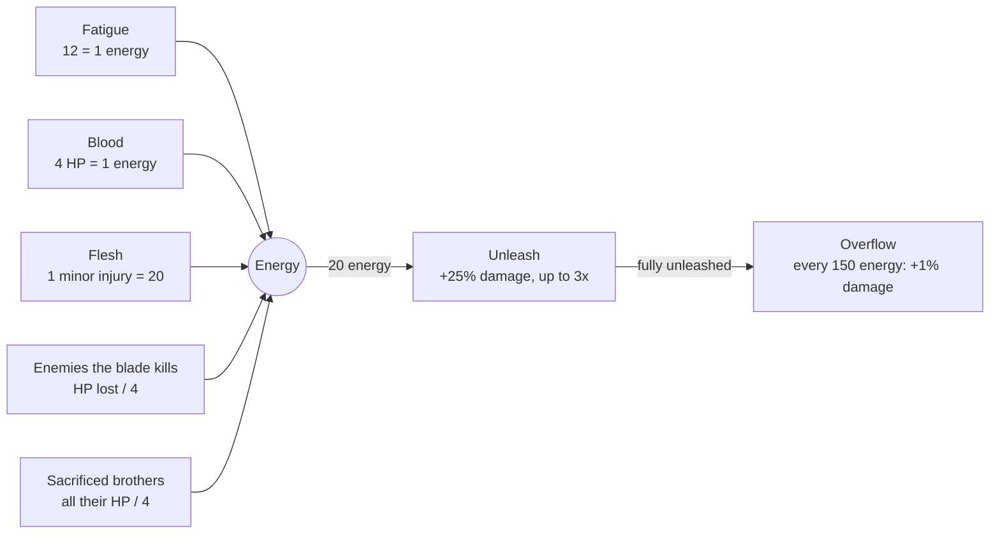

## Brother and Mass Sacrifice

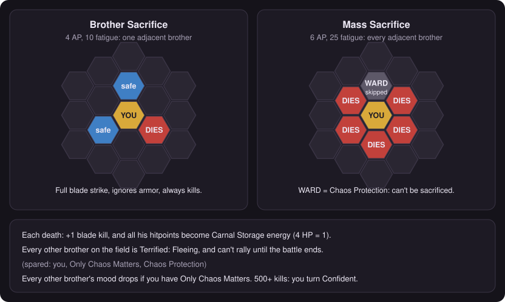

## Soul Arrow

The Devourer's gift when any of the company's Chaos Mind blades reaches **100 kills**, once per campaign.

 

- **Slot:** the quiver, but it holds no arrows, so a bow can't shoot with it.
- **Use:** once per battle, **+3 AP** this turn, even at full AP. Costs 20 fatigue.
- **Recharge:** after a battle it takes **15 ammo** from the company's supplies. With less than that, it stays empty until a later battle.

## Armor Fixer

A field repair kit; every armorer, north and south, stocks up to 3. Carry it in a bag slot. Using it costs 3 AP and repairs up to **50 armor**, body first, then the helmet. It's greyed out when there's nothing to repair.

 

## Perks

| | Perk | Effect |
|:-:|---|---|
|  | **Chaos Protection** (tier 1) | Immune to the black cloud and the curse. Can't be sacrificed. Never flees from sacrifice terror. Untouched by Chaos Circle. **−20 Resolve.** |
|  | **Vampire Allegiance** (tier 2) | Every kill heals him for 5% of the victim's maximum hitpoints, never above his own. Any weapon. |
|  | **Only Chaos Matters** (tier 3) | Immune to Hexe charm and Geist screams. No morale loss when allies die. Never flees from sacrifice terror. Other brothers can't raise his morale, and they come to hate him: mood drops after each sacrifice, after each battle and every day. |
|  | **Troll Allegiance** (tier 3) | All his recovery +20%: fatigue each turn in battle (15 → 18), hitpoints and injuries healing on the world map, and Vampire Allegiance's healing. |
|  | **Used to It** (tier 4) | Every attack that misses him gives +1 Melee and Ranged Defense until the battle ends, up to +10. Dodging costs no fatigue. |
|  | **Chaos Armor** (tier 5) | While wielding Chaos Mind: +1 Melee and Ranged Defense per +1% damage from kills, no cap. Melee Skill scaling doubles to +1% per point. |
|  | **Fatigue Transfer** (tier 6) | Grants the skill: 1 AP, moves all your fatigue onto an adjacent enemy (up to his maximum). Once every 3 turns. |
|  | **Chaos Circle** (tier 7) | Grants the skill below, usable only with Chaos Mind in hand. |

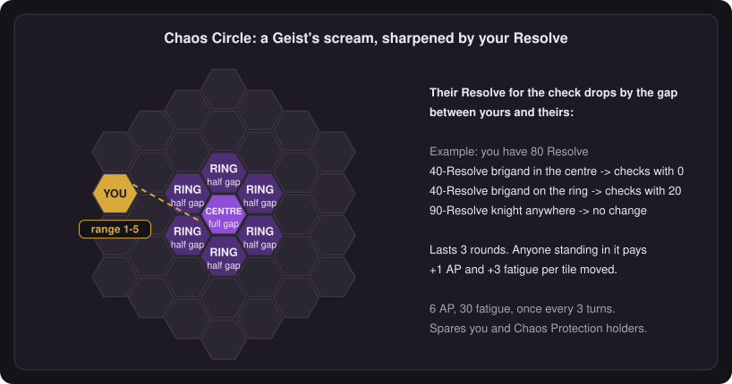

## The Black Skull

A three-part hunt that opens as the blade feeds: **100**, **200** and **500** kills, in order.

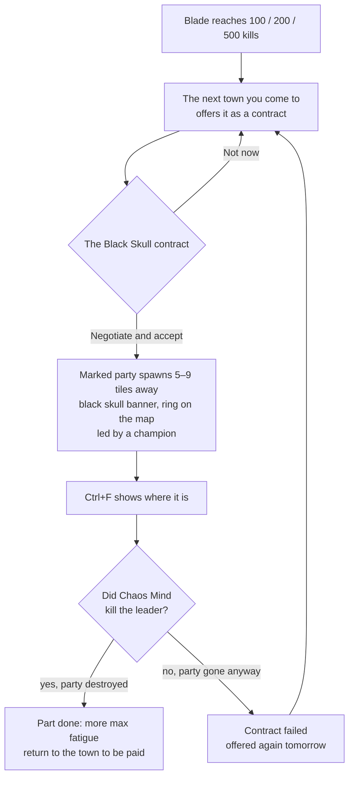

| Part | Kills | Enemy | Reward rate |
|:-:|:-:|---|:-:|
| I | 100 | Black Skull Brigands: five brigand champions, one of them the leader | 0.1 |
| II | 200 | Black Skull Reavers: twelve barbarian champions, one of them the leader | 0.25 |
| III | 500 | Black Skull Warband: fourteen orc champions, led by an orc warlord | 0.5 |

**Reward:** while wielding Chaos Mind, the brother gets **extra max fatigue equal to the rate × the blade's damage bonus from kills**, rounded down. It keeps growing as the blade kills.

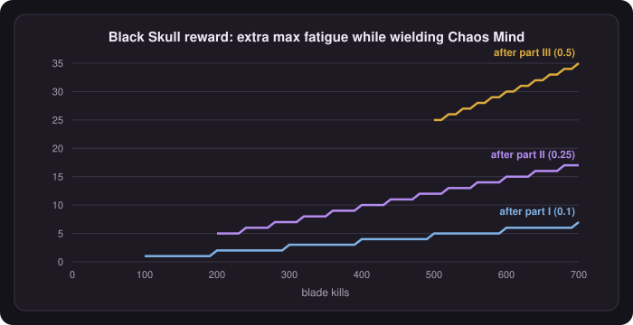

## Army of the Past

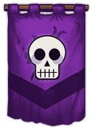

A three-part contract against hosts of the dead, offered by the next town you come to (purple banner, white skull): **50** skeletons at **100** kills, **100** at **200**, **150** at **500**. The host stands near the town in groups of 50, one battle each; destroy them all, then return to be paid.

The skeletons are plain Ancient Auxiliaries with half their usual hitpoints, never champions (not even from the blade), and their turns play six times faster so you don't wait on them. Every one the blade kills counts towards its kills.

## Aura of 10

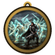

At **250 kills** on the blade, the next town you come to offers a contract to hunt **The Ten** (with a purple banner, paid in crowns as well): one party of ten named human champions, marked on the map near that town and left alone by other parties (Ctrl+F shows where). Kill all ten and you get **Aura of 10**, an amulet for the accessory slot. The hunt can't fail.

While any brother wears it, the company counts on the world map as at least **a company of ten seasoned men** (strength 220). Small and weak parties won't attack you and keep away, so you skip easy fights.

Every hunt is a real contract, so the game's own active-contract panel shows what to do, and its targets (the Black Skull party, The Ten, each Army of the Past group) are shown on the map from the moment they spawn, through the fog of war.

## The Red Dragon

> [!WARNING]
> **Experimental, off by default.** Switch it on in Mod Settings → Chaos Mind → Dev / Game breaking → *Red Dragon (experimental)*.

At **750 kills** on the blade, the next town you come to offers a contract to slay **the Red Dragon**. It fills **seven hexes**: its body in the middle, its head in front, its tail behind and two wings on each side. Hit any of them; they share one pool of 2000 health.

- It starts the battle in the air and **lands** near your company, throwing everyone next to it back a hex.
- It **breathes fire** on everything up to three hexes in front of its head, and the ground keeps burning for two rounds.
- Every third turn it **roars**, and every brother nearby checks morale.
- Every fourth turn, and when its health first falls below two thirds and one third, it **takes to the sky**: for one turn it can't be seen or hurt, then it lands somewhere else.

Its hoard and scales go to whoever slays it. To try the fight without the contract, press **Ctrl+D** (works with the setting off too): on the world map a Red Dragon lands next to your company and attacks it; in a battle one joins the fight.

## Leader duels

> [!WARNING]
> **Experimental, off by default.** Switch them on in Mod Settings → Chaos Mind → Dev / Game breaking → *Leader duels (experimental)*.

Not tied to Chaos Mind. When you engage a hostile party that has a leader, he may step out and demand single combat. Each party asks at most once.

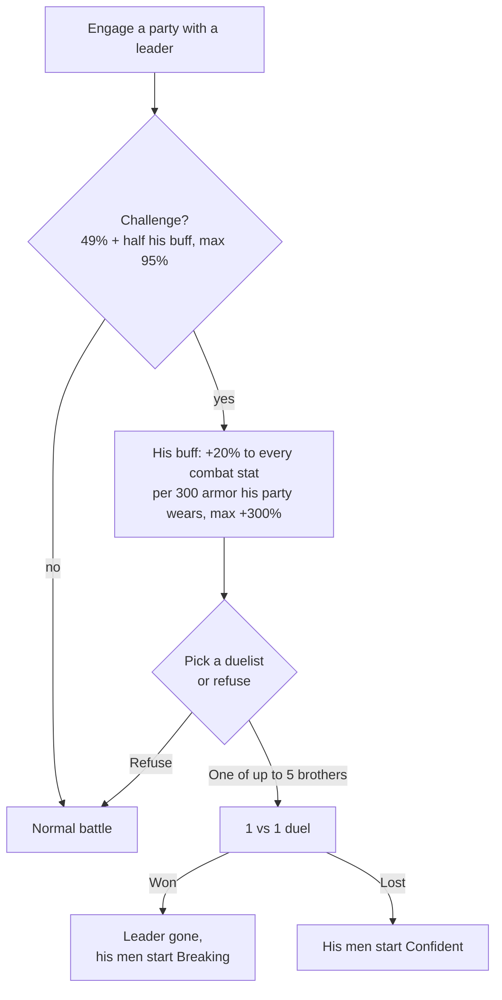

## Chaos Guide

A book with the full explanation of every item, skill and perk above, so the tooltips can stay short. It's given with the sword. If it's ever lost or sold, Chaos Mind's next kill puts it back in the stash. Open it with **Ctrl+G** on the world map or in battle, or right-click it in the stash.

 

## Hotkeys

| Key | Where | What |
|---|---|---|
| **Ctrl+F** | World map | Where The Frozen Eye is; once the sword is claimed, where the Black Skull's marked party is |
| **Ctrl+G** | World map, battle | Open or close the Chaos Guide |
| **Ctrl+B** | World map | *Experimental:* where every boss is, nearest first: the game's legendary locations and this mod's running hunts |
| **Ctrl+D** | World map, battle | *Experimental:* on the map a Red Dragon lands next to your company and attacks it; in battle one joins the fight |

All of them can be changed in Mod Settings.

## Mod Settings

Two pages, plus the keybinds.

**Gameplay:**

| Setting | Range | Default | What it does |
|---|---|---|---|
| Hidden enemy turn speed | ×1–×30 | **×25** | An enemy out of sight when its turn starts plays that whole turn this much faster. ×1 is the normal game |
| Normal enemy turn speed | ×1–×30 | ×1 | The same for enemies you can see. Your brothers and allies always play at normal speed |

**Dev / Game breaking**, Leveling:

| Setting | Range | Default | Normal game |
|---|---|---|---|
| Perk points per level | 1–10 | 1 | 1 |
| Attribute level-ups per level (rounds of raising three attributes) | 1–5 | **2** | 1 |
| XP multiplier | ×0.5–×20 | ×1 | ×1 |

Settings are stored in each save: a new campaign starts with the defaults, an older save keeps its own values.

Extra attribute rounds get their own rolled values, so talents still count. Brothers a campaign starts with above level 1 (the Lone Wolf starts at level 4) get the settings on their starting levels too:

  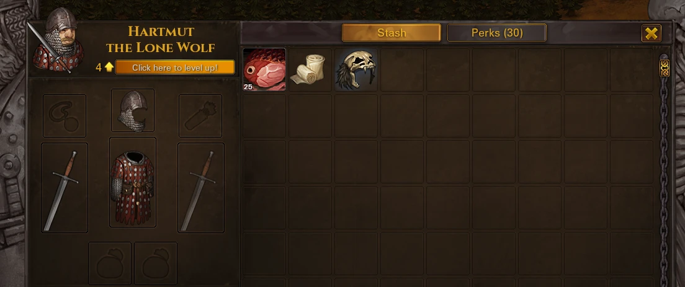
   
  <em>A new Lone Wolf with perk points per level at 10 and attribute level-ups at 5: 30 perk points to spend at the start.</em>

**Dev / Game breaking**, Recruiting:

- *Extra recruits per town*, 0–20, default **12** (0 is the normal game). Every town offers that many more recruits each time its recruits refresh; changing it in a campaign refreshes them at once.
- *Max hiring cost*, 0–3000 crowns, default **0** (no cap). No recruit costs more than this to hire; wages and the tryout fee don't change.

**Dev / Game breaking**, Extra content and Experimental: *Red Dragon*, *Leader duels* and *Saves load without the mod*, all off by default.

## Status

Built and tested piece by piece. The Red Dragon, leader duels and the Ctrl+B boss list are experimental: they have broken battles, so the dragon and duels are off by default. A few features haven't been tried in play yet: Chaos Circle's resolve-gap scream and parts 2 and 3 of the Black Skull. The game's own scripts are encrypted, so some names had to be guessed. Every guessed name is guarded: a wrong one logs a warning in `log.html` instead of crashing.

## Art

The sword, perk and skill icons and the sword's sprites were made from separate source images, which aren't included here. A few icons are recoloured vanilla Battle Brothers art: the Chaos Guide book and the Armor Fixer. The Black Skull's map banner is the game's own. The diagrams in `docs/images` are generated by `docs/make_diagrams.py`.

## License and credit

Chaos Weapon Mod is licensed under [Creative Commons Attribution 4.0 International (CC BY 4.0)](https://creativecommons.org/licenses/by/4.0/). The full text is in [`LICENSE`](LICENSE).

You may use, change and share it, including in your own mods, as long as you give credit. If you share a mod that uses or changes any part of it, put this in your mod's description (on Nexus, Steam, GitHub or wherever you publish it):

> Based on [Chaos Mind](https://github.com/JustDragos/Chaos-Weapon-Mod) by JustDragos

and say what you changed.

**Not covered by this license:** art taken from Battle Brothers itself belongs to Overhype Studios and stays under their terms. That's the Chaos Guide book and the Armor Fixer icons (recoloured vanilla art), the Black Skull's map banner, and the vanilla snow mound under The Frozen Eye's map sprite. MSU and Modern Hooks are separate mods with their own licenses and aren't included here.
